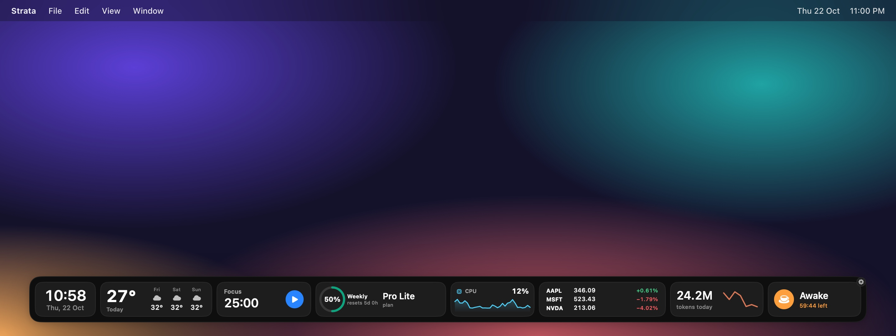
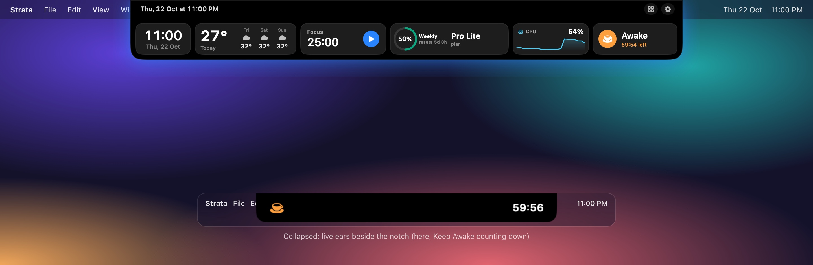
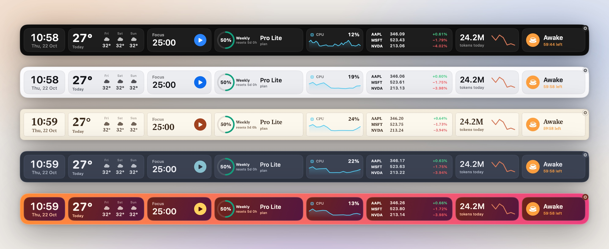
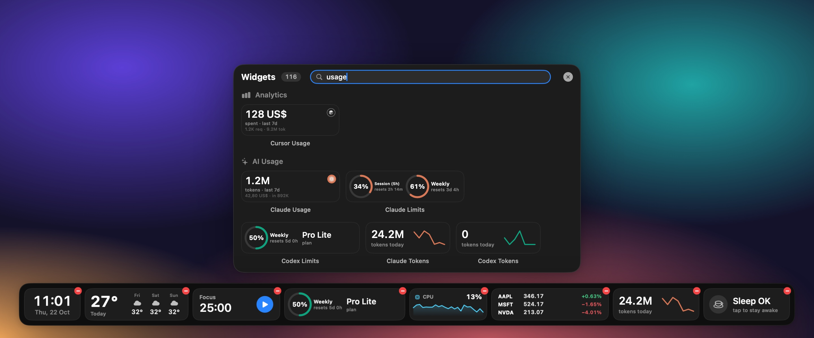
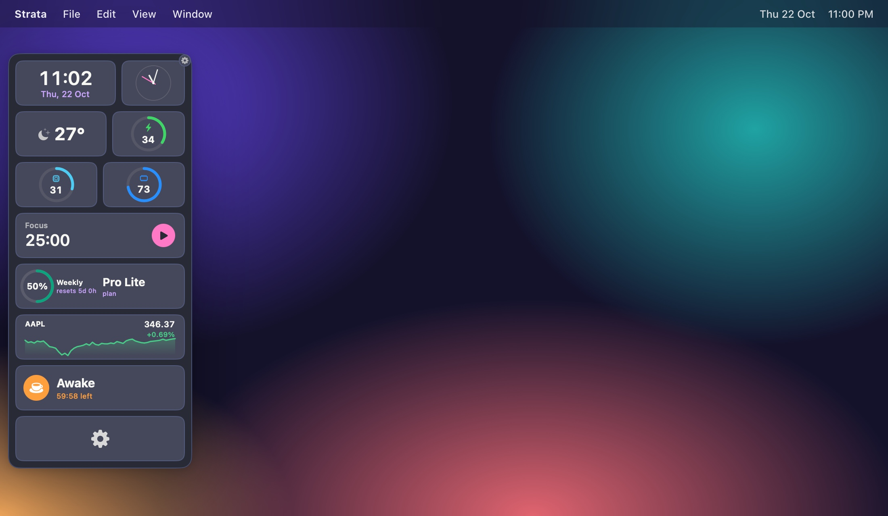
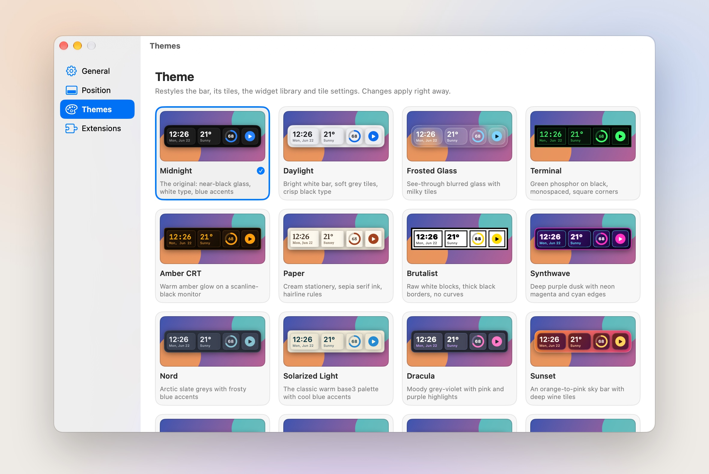

<p align="center">
  
</p>

<h1 align="center">Strata</h1>

<p align="center">
  <b>A calm widget bar that takes the place of your Dock.</b><br>
  Your apps, your day and your machine, on one quiet strip at the edge of the screen.
</p>

<p align="center">
  <a href="https://github.com/akhil-gautam/strata/releases/latest"></a>
  
  
  <a href="#install"></a>
</p>

<p align="center">
  <a href="#install">Install</a> ·
  <a href="#a-look-around">Screenshots</a> ·
  <a href="#whats-inside">What's inside</a> ·
  <a href="#extensions">Extensions</a> ·
  <a href="#automation">Automation</a> ·
  <a href="#privacy-and-performance">Privacy</a> ·
  <a href="#build-from-source">Build</a>
</p>

<br>



<br>

## Why Strata

- **One bar instead of three.** Launchers, widgets and menu-bar odds and ends live together, on the edge you choose. The macOS Dock steps aside while Strata is on screen and comes back when you quit.
- **Glanceable, not busy.** Every tile is the same height and shows one thing well: the time, the next meeting, your CPU, how much of your Claude limit is left.
- **Made for the notch.** In Island mode the bar folds into the camera housing and opens on hover, with live status beside the notch.
- **Light on your Mac.** It idles at about 1% CPU, and only the tiles on your bar ever do any work.

## Install

```bash
brew trust akhil-gautam/tap
brew tap akhil-gautam/tap
brew install --cask strata
```

Requires **macOS 26 (Tahoe)** or later. Strata is signed with a Developer ID but not notarized yet, so the cask removes the download quarantine flag; macOS may still ask you to confirm the first launch in **System Settings › Privacy & Security**.

To update: `brew upgrade --cask strata`.

## A look around

<table>
  <tr>
    <td colspan="2">
      
      <p><b>At the notch.</b> In Island style the bar folds into the camera housing and opens with a soft glow when you hover. While it's closed, small "ears" beside the notch show what's going on: an agent that needs you, a focus timer, Keep Awake, music.</p>
    </td>
  </tr>
  <tr>
    <td colspan="2">
      
      <p><b>Twenty themes.</b> Each restyles the bar, every tile, the widget library and the settings popovers: Midnight, Daylight, Paper, Nord and Sunset shown here.</p>
    </td>
  </tr>
  <tr>
    <td width="50%" valign="top">
      
      <p><b>The widget library.</b> Search 110+ tiles and click to add. While it's open, bar tiles show remove badges and you can drag them into a new order.</p>
    </td>
    <td width="50%" valign="top">
      
      <p><b>Any edge.</b> Bottom, notch, left or right. Down the side, tiles pack into neat, even rows.</p>
    </td>
  </tr>
  <tr>
    <td colspan="2">
      
      <p><b>Settings that stay out of the way.</b> Themes, position, displays, shortcuts and extensions, all in one window.</p>
    </td>
  </tr>
</table>

## What's inside

### The bar

- Bottom, left, right, or hanging from the notch (Island or Classic style).
- Auto-hide; hides over full-screen apps; on one display or following the pointer between displays.
- Drag tiles to reorder them; right-click any tile for its actions and settings.
- Hides the macOS Dock while shown and restores your setting on quit.

### Dock essentials

- **AI Usage.** Claude Code and Codex rate limits with reset countdowns, today's tokens with a 7-day sparkline, and **Agent Status**: a live view of every Claude Code, Codex and omp session (working, needs you, done), with a notification when a long turn needs you or finishes. It reads Claude Code's own sign-in and the agents' local logs, so there's nothing to paste.
- Right-click an app for its **window list**, Hide, Quit and Force Quit.
- **Drop files** on an app to open them with it; Running Apps and Trash tiles.

### 110+ tiles

| | |
|---|---|
| **Clocks & timers** | Digital, analog, flip and world clocks · stopwatch · timer · Pomodoro · Keep Awake |
| **Calendar** | Today, next event, week and agenda · next meeting with a Join button · Meeting Center with mic mute and camera check · reminders |
| **Weather** | Current, details, hourly, 4-day forecast, wind, sunrise and sunset, for any city in °C or °F |
| **System** | CPU, RAM, network and storage gauges and charts · battery · audio output and per-app volume · mic mute · quick toggles |
| **Everyday tools** | Clipboard history (images too) · file shelf · recent files and screenshots · screenshot capture · AirDrop · colour picker · unit converter · voice memos · notes · bookmarks · emoji |
| **Media & people** | Now playing for Music and Spotify · latest photo · quick contacts · unread mail |
| **Work** | Stripe and Polar revenue · DataFast visitors · X, YouTube and TikTok followers · stocks and watchlists · Claude and Cursor org usage |

## Extensions

Switch these on in **Settings › Extensions**.

- **AI Usage.** Claude Code and Codex rate limits with reset countdowns, today's tokens with a 7-day sparkline, and **Agent Status**: a live view of every Claude Code, Codex and omp session (working, needs you, done), with a notification when one needs you. It reads Claude Code's own sign-in and the agents' local logs, so there's nothing to paste.
- **Script Tiles.** Drop any executable into `~/Library/Application Support/Strata/Scripts` and it becomes a tile. Name it like an xbar plugin (`weather.5m.sh` runs every 5 minutes) and print text or JSON. A script never runs until you approve it, and editing it asks again.

```json
{ "value": "86%", "caption": "battery", "icon": "battery.75percent", "progress": 0.86 }
```

- **No accounts, no analytics.** Everything runs on your Mac. Network tiles fetch only their own data (weather, quotes, Claude limits and the services you connect), and the keys you paste are stored in your keychain.

| Shortcut | Action |
|---|---|
| <kbd>⌃</kbd> <kbd>⌥</kbd> <kbd>D</kbd> | Show or hide the bar |
| <kbd>⌃</kbd> <kbd>⌥</kbd> <kbd>W</kbd> | Open the widget library |

Settings, focus and Keep Awake can have shortcuts too. Shortcuts work in every app and need no permissions.

Scripts, Shortcuts and other apps can drive Strata with links:

```bash
open strata://toggle        # show, hide, toggle
open strata://library       # settings, refresh
open strata://focus/start   # focus/pause
open strata://awake/on      # awake/off
```

## Privacy and performance

- **No accounts, no analytics.** Everything runs on your Mac. Network tiles fetch only their own data (weather, quotes, and the services you connect), and the keys you paste are stored in your keychain.
- **Permissions are asked for only when a tile needs them:** Calendar, Reminders, Photos, Contacts, Accessibility (badges and window lists) and Automation (Mail, media players).
- **Light.** Measured on a 14-inch MacBook Pro: about 1% CPU and under 65 MB of memory with every extension tile on the bar. Services only run for tiles that are on your bar.

## Build from source

```bash
git clone https://github.com/akhil-gautam/strata.git && cd strata
scripts/build-app.sh release      # builds, assembles and signs build/Strata.app
open build/Strata.app
```

Set `STRATA_NOTARY_PROFILE` to a `notarytool` keychain profile to notarize and staple the build. `scripts/make-icon.sh` regenerates the app icon from `Resources/AppIcon.svg`.

<br>

<p align="center"><sub>Made with SwiftUI and AppKit for macOS 26.</sub></p>
